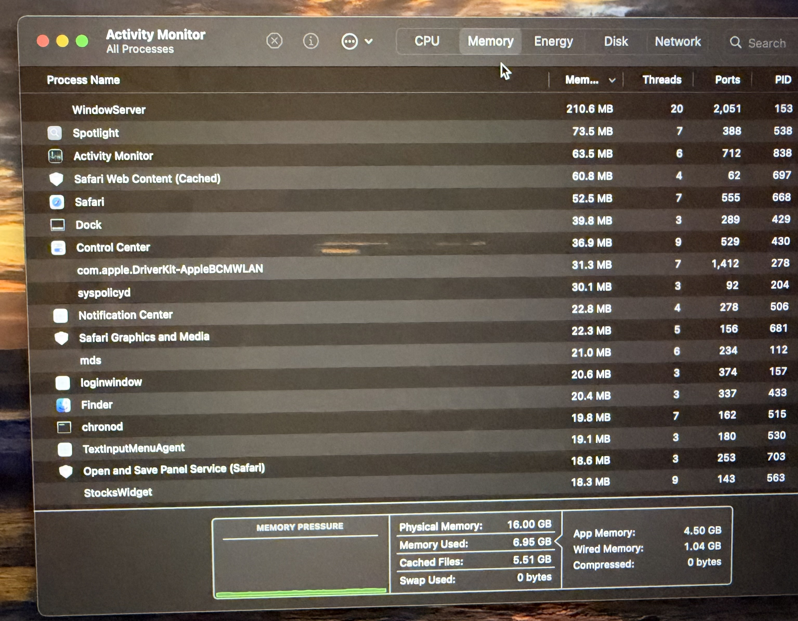

Day 1: Tools for Troubleshooting

Task 1: Uses of a Multimeter

A multimeter is an electronic testing tool used to measure voltage, current, and resistance. It helps technicians identify electrical problems in computers and smartphones.

No.| Real-Life Scenario| How the Multimeter Helps
1| Laptop charger not working| It checks the charger's output voltage to identify whether it is supplying proper power.
2| Smartphone charging cable problem| It checks the continuity of a disconnected charging cable to find a broken wire.
3| Laptop battery problem| It measures battery voltage to check whether the battery is providing the required power.

Conclusion: A multimeter helps technicians identify electrical faults and troubleshoot computer and smartphone problems.

---

Task 2: POST Card Demonstration

A POST (Power-On Self-Test) card is a diagnostic tool used to identify hardware problems during the computer startup process.

A POST card displays diagnostic codes that help technicians identify hardware faults.

Summary:

1. A POST card is used to check whether the computer hardware is working properly during startup.
2. It displays diagnostic codes that indicate the progress of the Power-On Self-Test.
3. Different codes help identify problems related to the CPU, RAM, motherboard, and other hardware components.
4. Technicians use these codes to identify hardware problems and troubleshoot the computer.

Conclusion: A POST card makes it easier to identify hardware problems when a computer fails to start properly.

---

Task 3: Software Diagnostic Tool
## Task 3: Software Diagnostic Tool

Note: I am using a MacBook, so I used Apple's built-in Activity Monitor to check system health details such as memory usage and memory pressure instead of HWMonitor.
Selected Tool: HWMonitor

HWMonitor is a free hardware monitoring tool that displays important system health information.

Main Features of HWMonitor:

1. It displays CPU temperature.
2. It monitors system voltage.
3. It shows fan speed.
4. It displays battery voltage and temperature on supported laptops.
5. It helps monitor the overall hardware condition.

Steps to Use HWMonitor:

1. Download HWMonitor from the official CPUID website.
2. Install the software on the computer.
3. Open HWMonitor.
4. Check the CPU temperature, voltage, and other hardware details.
5. Take a screenshot of the main dashboard.
6. Blur or crop any personal information before uploading the screenshot.

Screenshot:
Insert your actual HWMonitor dashboard screenshot here.

Conclusion: HWMonitor helps users monitor hardware health and identify possible overheating or voltage-related issues.
